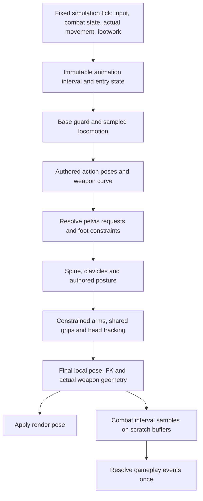

# AT-013 — Upper-body and full-body animation architecture

Status: research and proposed architecture only. No new animation system or proof of concept implemented in this session.

Audit date: 2026-11-19. Scope: current local `testing/knight-footwork` working tree, based on `db4ce28`, containing the imported PR #1 work (`a233cf4`) and subsequent local knight/sword/footwork adaptations. This includes local files that are not published on GitHub. Repository: https://github.com/LimeyJuicy/Game1 . Existing claims below come from source inspection and the explicitly listed checks; proposed designs are not implementation claims.

## Recommendation

Use **authored joint poses and full weapon transforms as the artistic source, analytical arm IK as a constrained correction, and one deterministic full-body pose evaluator shared by editor, renderer and combat**. Keep the existing footwork planner, lower-body constraint solver, gameplay timeline and Three.js rendering/track utilities. No additional animation framework is justified now.

This is Approach A with selected capabilities from B and C. Choreography defines the motion; procedural constraints accommodate measured anatomy, supported feet, targets and actual collision-limited travel. Build a small authoring surface early. A solver that can only be tuned by editing hard-coded functions would repeat the current creative-control problem.

## 1. What the code actually implements

### Two actors and update paths

| Area | Existing implementation | Reuse / change |
| --- | --- | --- |
| Live combat actor | `src/knight.ts:13`, `src/humanRig.ts:14`: native 55-bone procedural knight; proxy body/sword/foot controls drive the skeleton | Preserve as migration fallback; do not treat it as the imported model |
| Approved imported actor | `AT-007-Footwork/viewer/importedKnight.ts:20`: fitted 66-bone GLB; measured anatomy, axis corrections, two-hand sword carry, Quaternius idle plus PR foot constraints | Target actual-mesh authoring here; extract rig calibration from the viewer into a shared profile |
| Combat timeline | `src/combat.ts:29` SwordActions: preparation/swing/recovery, serials, fresh input, bounded light buffer, cancellation rules | Reuse authoritative action state; extend definitions incrementally |
| Existing attacks | `src/combat.ts:11`: three light definitions, three heavy definitions, riposte and periodic backspin variant; `src/knight.ts:73` generates their motion | Keep timing/commitment tests; replace hard-coded choreography for migrated techniques |
| Existing arm/leg IK | `src/humanRig.ts:189` analytical two-link solve; `twoHandCarry.ts:79` analytical two-arm placement on one handle | Reuse mathematics and grip conventions, add profiles, limits and authored preferences; do not reuse all hard-coded offsets |
| Footwork | `src/footwork/controller.ts:513` advances state; `:562` reads constraints; `:579` snapshots/restores. `legs.ts:119` solves measured anatomy | Preserve planner/foot locks and optional anatomy API; adapt outputs to the new resolver |
| Footwork game integration | `src/footwork/game.ts:33`, `src/main.ts:67`: optional `?footwork`; gameplay owns actual root travel | Retain behind flag during migration; remove display/hit offset split when a technique migrates |
| Tools | Footwork viewer: history/timeline, slow playback, scripts, skeleton/contact overlays, live guard/lunge parameters, copy JSON | Extend this bench; no new site required |

Paths under AT-001 and AT-007 in this report are relative to `Animation Testing/` unless prefixed with `src/` or `tests/`. Line references describe the audited snapshot and can move later.

### Bone hierarchy and independence

Inspected the actual GLB JSON skin, not only documentation: 66 joints and 43 supplied clips. Relevant imported chain:

```text
root → pelvis → spine_01 → spine_02 → spine_03 → neck_01 → Head
                                       ├→ clavicle_l → upperarm_l → lowerarm_l → hand_l → fingers
                                       └→ clavicle_r → upperarm_r → lowerarm_r → hand_r → fingers
```

| Region | Native skeleton | Imported skeleton | Limitation today |
| --- | --- | --- | --- |
| Pelvis | Pelvis | pelvis | Exists independently, but several update paths contribute to it |
| Lower/upper spine | Spine → Ribs → Chest | spine_01 → spine_02 → spine_03 | Adequate segments for distributed bend/twist; no reusable authored-pose layer |
| Neck/head | Neck → Head | neck_01 → Head | Both bones exist. Native update explicitly drives Head, not an independent neck animation; imported adapter adjusts Head and inherits source neck keys |
| Shoulder/scapula | Clavicle → Shoulder each side | clavicle → upperarm each side | Independent chains exist; native protraction is heuristic translation, not calibrated scapular authoring |
| Upper arm/elbow | Shoulder → Elbow | upperarm → lowerarm | Suitable for two-link position IK |
| Forearm twist | Separate Forearm twist bone | No separate twist-distribution bone | Imported forearm can rotate, but no extra weighted bone to distribute pronation along the mesh |
| Wrist/hand | Wrist → Hand | hand bone serves wrist/hand rotation | Imported wrist and palm are not two independent anatomical joints; fingers are separate |
| Weapon | Proxy sword parented to body; hands solved to it | Actual sword parented to hand_r with fixed socket; off-hand has second grip | Shared weapon/grip concept is reusable; arbitrary weapon-space attacks are not implemented |

The imported rig is sufficient to prove guards and a constrained extension. It does not yet justify claiming clean extreme wrist/shoulder poses: plate, finger and cloth skinning remain unresolved. Additional twist bones would require weight/asset work, not simply a new solver flag. Do not replace the whole rig before testing its existing articulation.

### Current authoring and ownership limitations

1. `knight.ts:52` captures **control objects**, not a general skeletal PoseBuffer. PoseAttack, poseDefense, animate and rig.update share mutable closure state and overwrite related controls/bones in sequence.
2. `humanRig.ts:269` hard-codes spine distribution; `:299` overwrites clavicle placement; `:306` solves arms to fixed sword grip points; `:311` heuristically distributes twist. An external artist adjustment can be overwritten on the next update.
3. Imported `twoHandCarry.ts:28` hard-codes scale, weapon direction and grip; `:65` bakes five source-motion adaptations at 60 fps. It is a carry experiment, not a general pose/attack authoring system. Fingers retain bind shape.
4. Imported `importedKnight.ts:50` combines source clip sampling, footwork overrides and direct bone writes. It explicitly resets/re-activates its mixer because unchanged cached source samples previously allowed procedural corrections to accumulate. `tests/footwork-imported.test.ts:59` protects repeated paused redraw.
5. Native actor faces -Z. Imported source faces +Z at normalized height 1.0; adapter turns it 180 degrees and scales to 1.8 metres (`importedKnight.ts:24`). Bone local axes differ. Sword blade axis is local +Y. Authoring data needs declared frames and units.
6. Current named en-garde/low/high definitions describe **feet and hips** (`stances.ts:4`), not complete upper-body fencing guards. Imported arms retain shoulder carry during these studies.
7. Workbenches have no general bone picking/rotation editor, IK target editor, pose library import/export, attack keyframe editor, layer inspector or editable sword-path asset. Existing JSON copy exports footwork tuning, not upper-body poses.

### Hit sampling: confirmed behavior, with nuance

- Fixed game step is 1/60 (`src/main.ts:136`). `sampleSwordHit` clips to the swing and evaluates attack poses at intervals no larger than 1/120 (`:358–365`); `sweptBladeHits` additionally interpolates segments at roughly 5 cm endpoint displacement spacing (`combat.ts:103`). This is sampled collision approximation, not exact continuous collision detection.
- `poseAttack` is **not globally pure**: it captures entry pose on serial change and maintains attacking/return/spin/grip state (`knight.ts:73`). Nevertheless, it already fixes entry pose for a given serial. A read-only diagnostic evaluated time .22, then .40, then .22 for the first light attack with unchanged context: blade error was 0. This existing protection should be preserved, not described as proven drift in every current attack.
- `src/main.ts:536` updates footwork before hit sampling. `:546` disables its carrier for hits; `:548` restores it for the displayed pose. `footwork/game.ts:101` explicitly documents the split. **Actual display-versus-hit transform mismatch exists under the optional flag.**
- Root has already moved by the time the blade samples run; those calls do not resample the whole root/footwork trajectory at each sub-time. Repeated sword samples alone are not full-body time sampling.
- Riposte is a separate scripted-contact path (`main.ts:348`): a contact time, range <=1.7 and clear sight award the hit. It bypasses ordinary blade sweeps. Preserve the earned guaranteed-counter design through an explicit contact policy; do not accidentally turn it into an ordinary reach-based miss while refactoring.
- Main action progression is already explicit (`main.ts:612`); attack start also poses once at time zero (`:302`). This supports an evolutionary separation of progression and evaluation.

## 2. Three approaches compared

These are architectural judgments for this codebase, not measured quality or benchmark claims.

| Criterion | A: authored poses + arm IK | B: authored clips + layered blending | C: procedural full-body controller |
| --- | --- | --- | --- |
| Visual quality ceiling | High with skilled pose/trajectory authoring and cleaned weights | High with well-authored clips; blending alone cannot repair poor source motion | Variable; plausible reach can still look stylistically wrong |
| Creative control | Direct control of torso, timing, elbow character, handle/edge path | Excellent within edited clips; changing style requires clip-editing tools | Parameters can control style, but formulas tend to grow for individual techniques |
| Fencing specificity | Strong: guard, blade line, preparation, contact and recovery authored explicitly | Strong with fencing-specific clips; generic library is insufficient | Strong only if authored technique preferences are added |
| Add an attack | Reuse named poses/path/phase data; limited corrective solver tuning | Author/clean a clip plus phase/contact markers and variants | Usually new trajectory rules and exception handling unless converted into data |
| Fit to current Game1 | Best: analytical arms, foot constraints, three-phase clock already exist | Good for existing 43 clips; needs masks and shared evaluation wrapper | Existing footwork is a useful subset, not a full-body procedural framework |
| Runtime cost | Predictable for two analytical arms and existing leg solver; bounded torso correction | Efficient track sampling/blending; IK still needed for two-hand/foot contacts | Variable with coupled constraints/iterations; must cap work per sample |
| Implementation complexity | Moderate; principal cost is authoring data, calibration and ownership | Moderate for playback; substantial for a responsive browser authoring editor and constraints | Highest for generalized coordinated movement and graceful infeasibility |
| Debugging | Authored pose, target, solved pose and residual can be compared directly | Tracks/weights easy to inspect; overlapping bindings and crossfade contact loss need care | Emergent coupling makes it difficult to attribute a strange pose to one rule |
| Testability | High with immutable inputs and explicit constraints | High with isolated absolute-time sampling; weaker with live-mixer side effects | High mathematical testability, but numerical success poorly predicts choreography |
| Maintenance | Data grows with techniques; small solvers remain shared | Asset/version/retargeting maintenance; avoid explosion of stance×move×attack clips | Complex rules grow; a new constraint can alter many techniques |
| Existing footwork | Preserve planner and solve feet after compatible pelvis contributions | Mask lower-body tracks and reapply foot constraints after blending | Could subsume footwork, but replacing it now offers little benefit |

### A — authored poses and IK: recommended foundation

Store intended skeletal shape plus full weapon goals. Solve shoulder/elbow position analytically, then calibrated forearm roll/wrist orientation with limits. Author elbow swivel/pole and preferred arm posture; do not ask the solver to invent fencing style. Torso/clavicle motion is principally authored, with small bounded adjustments.

The current two-link math is appropriate for each upperarm–lowerarm–hand chain. Add minimum bend, near-collinear fallback, profile-based limits, preferred branch and reach diagnostics. Position-only analytical IK does not automatically solve shoulder twist, wrist limits, blade roll or self-collision.

Iterative options:

- **CCD:** Three.js supplies CCDIKSolver with helpers, iterations and link rotation limits. Its target and effector refer to skeleton bone indices; the implementation solves effector position. It is not a ready-made world-space 6D weapon controller or coordinated closed-chain two-hand solver. Use for a bounded experimental residual chain only if analytical arms prove insufficient. [Official documentation](https://threejs.org/docs/pages/CCDIKSolver.html), installed `examples/jsm/animation/CCDIKSolver.js:116`.
- **FABRIK:** Useful for longer chains and multi-effector structures; orientation and human joint constraints still need deliberate treatment. A possible later torso/clavicle reach solver, not a reason to replace the functioning two-link legs/arms now. [Author's paper and constrained extension](https://www.andreasaristidou.com/FABRIK).
- **Damped least squares:** Attractive when jointly optimizing tip position, orientation and multiple chains. Adds Jacobians, weighting, singularity handling and tuning. Reserve for a demonstrated coupled-constraint need. The research specifically treats unreachable-target oscillation; endpoint error alone is not a choreography objective. [Buss and Kim](https://mathweb.ucsd.edu/~sbuss/ResearchWeb/ikmethods/).

### B — clips and blending: retain as a source format

Three.js already supplies track sampling, weighted actions, normal/additive blending, fades and synchronization. Bone-region masks can be built by filtering tracks; a mixer action's weight is not an independent per-bone mask. Build masks in shared pose evaluation rather than assuming a turnkey anatomical layer graph. Additive clips require a defined reference pose; offsets from arbitrary references will distort the result. [AnimationAction](https://threejs.org/docs/pages/AnimationAction.html), [AnimationUtils](https://threejs.org/docs/pages/AnimationUtils.html).

Clips are valuable for approved locomotion, authored motion detail and optional baked export. Editing a raw quaternion track is less convenient than adjusting “elbow lower, tip higher,” so keep pose/weapon authoring data and compile or sample tracks as needed. Crossfading separately authored two-hand animations may separate grips or shorten a blade arc; re-solve contacts afterward.

For deterministic collision samples, sample tracks into a private PoseBuffer or scratch rig with explicit time/weights. `AnimationMixer.setTime` changes mixer time and applies animation; it is not a gameplay-pure pose query by itself. Installed PropertyMixer:231 writes a binding only when its accumulated value changes, explaining our earlier post-mixer overwrite issue. Do not put a mixer and an IK pass in competition on the live skeleton. [Mixer docs](https://threejs.org/docs/pages/AnimationMixer.html), [track interpolation](https://threejs.org/docs/pages/Interpolant.html).

### C — procedural full body: use selectively

A general solver could optimize foot contacts, pelvis, torso, two hands and weapon pose together. That is flexible, but there is no unique natural posture for a tip target. It would need authored posture priors, joint limits, support rules and transition timing—the artistic data from A anyway.

Use procedural systems for foot locking, limited tracking, constrained reach and contact response. Keep a bounded torso adjustment budget, then report or shorten an unreachable motion. A universal balance/physics/animation optimizer is unnecessary for the first thrust. The existing hip springs are useful motion shaping, not a complete mass-based balance model.

## 3. Unified evaluation and bone ownership

Only a final adapter writes the render skeleton. Layers produce pose data or constraints; they do not call independent setters on live bones.



| Region/resource | Final ownership | Contributions and conflict rule |
| --- | --- | --- |
| Root translation/facing | Gameplay movement in game; existing footwork root planner in bench | Action requests travel; movement grants collision-limited path. IK cannot move the actor through a wall |
| Pelvis | Pelvis/support resolver | Footwork supplies baseline; action requests bounded yaw/lean/shift before the leg solve; reach correction can lower/shift hips |
| Feet, thighs, calves, toes | Lower-body constraint resolver | Footwork determines support/anchors. Authored preferred shapes influence permitted motion, not the location of a locked sole |
| Spine/chest | Torso compositor | Guard base + authored action + bounded locomotion/breathing offsets; distribute bend/twist across actual joints |
| Clavicles | Upper-body resolver | Authored shoulder shape/protraction plus bounded reach assistance; avoid arbitrary arm-length-changing translations |
| Upper arms/elbows | Arm solver within upper-body resolver | Authored pose is preferred shape/branch; IK weight can vary per action phase |
| Forearm/wrist/hands | Upper-body resolver | Joint limits, weapon orientation and grip closure. Imported rig lacks separate twist-distribution bone |
| Fingers | Grip pose layer | Named grip shapes/explicit releases; fingertip IK is a later need |
| Neck/head | Head resolver | Authored intent plus bounded target look and stabilization; never rotates chest to satisfy a look target |
| Weapon | One final resolved transform | Author weapon goal; derive grip constraints. Renderer/collision consume the same resolved FK transform |
| Damage, cancel, hit/VFX events | Gameplay action/controller | Evaluator returns geometry/diagnostics only; no events during sampling |

Resolution order matters: merge pelvis requests **before** solving planted legs. If a later reach correction changes pelvis, recompute leg constraints in the same evaluation. Do not clamp joint angles after IK and then silently accept broken grips; solve within limits or report residual error.

Support and joint limits constrain the requested motion. If a goal is infeasible, keep root collision, supported feet and anatomical limits; sacrifice requested reach/trajectory accuracy with explicit diagnostics. Balance starts as authored weight transfer plus bounded support-aware heuristics. A static center-of-mass-inside-support test would not establish physically correct lunging dynamics.

Override layers use semantic per-bone masks and normalized blends within a priority tier; additive offsets use one declared reference and a fixed composition order. Quaternions are normalized, with consistent hemisphere handling. Full-body reactions can reserve their masks exclusively; root collision rules still apply. “Last function called wins” is not a conflict policy.

## 4. Proposed modules and data contracts

Start with three shared modules (rig profile/pose math, definitions, evaluator/arm solving), then split when needed. Suggested eventual responsibilities:

| Proposed module | Concrete problem solved |
| --- | --- |
| `src/animation/rigProfile.ts` | Semantic bone map, rest axes/transforms, measured lengths, joint limits, sockets, weapon geometry and units; native/imported adapters |
| `pose.ts` | Local pose buffers, masks, FK, quaternion blending, reset-to-reference and per-bone deltas |
| `definitions.ts` plus JSON assets | Validated, versioned guard/pose/action/trajectory data shared by game and bench |
| `upperBodyIK.ts` | Analytical arms, preferred elbows, limits, grip residuals; optional bounded iterative correction later |
| `evaluate.ts` | Deterministic layer composition and final skeletal/weapon evaluation |
| `controller.ts` | Thin integration with SwordActions, PlayerDefense and footwork; captures entry/interval state and advances once |
| Existing bench extension | Draft editing, visualization, version comparison, import/export and playback via the same evaluator |

Proposed interface sketch, not executable implementation:

```ts
type PoseBuffer = { translations: Float32Array; rotations: Float32Array };

type EvaluationContext = Readonly<{
  tick: number;
  gameTime: number;
  actionId: string | null;
  actionSerial: number;
  actionTime: number;
  entry: FrozenTransitionPose;
  rootPath: FrozenMotionPath;
  footwork: FrozenFootworkInterval;
  target: FrozenTargetSample;
  contacts: FrozenContactState;
  definitionVersion: string;
}>;

function advanceAnimationState(previous, input, dt, movementResult): {
  state: AnimationState; interval: FrozenInterval; events: CommittedEvent[];
};
function evaluatePose(context: EvaluationContext, out: PoseBuffer, scratch): {
  weaponWorld: RigidTransform;
  bladeWorld: BladeSegment;
  diagnostics: ConstraintReport;
};
function applyPoseToSkeleton(profile, pose: PoseBuffer): void;
```

Existing footwork `advance` is called once inside the progression/integration step, not again by every layer. Keep SwordActions as gameplay authority initially; do not create a competing action state machine. Generalize its phase data only when integrating a migrated technique. One scaled simulation clock supplies action/footwork times. Existing real-time slow-motion emphasis, hit stop and camera/UI timing remain separate presentation clocks; they must not independently drive the collision skeleton.

“Pure evaluation” means no mutation of gameplay state, input snapshots, asset definitions, live bones or event queues. Caller-owned output/scratch buffers and isolated interpolation caches are allowed. Definitions/targets/solver seeds must be part of the context or keyed by it; no hidden dependency on whichever sample ran most recently.

## 5. Authoring representation

Use a hybrid, rather than choosing either all joint angles or all targets:

- Named guard/body poses store **local rotations relative to a calibrated reference** for spine, clavicles, head and preferred arms. Store quaternions; expose anatomical angles in the UI. Bone lengths remain in the rig profile. Root/pelvis translations and limited scapular adjustments are explicit channels, not unrestricted per-bone stretching.
- Weapon keys store **position and orientation**, a declared space (`actor`, `attackStart`, `chest` or captured target frame), interpolation/tangents and explicit rotation winding when needed.
- IK keys store elbow swivel/poles, grip mode, preferred bend and correction weights. “Bend the elbow more” changes an authored preference/weapon reach, not an impossible extra hard constraint alongside a fixed wrist.
- Definitions reference reusable poses by ID/version; masks allow partial overrides. Export resolved assets with dependency IDs and rig/weapon profile identifiers. Reject incompatible profiles and unknown units on import.

Example authoring asset structure:

```text
schemaVersion, id, rigProfileId, weaponProfileId
baseUpperGuard, optionalFootStance
jointKeys: bone, time/marker, referenceDelta, easing
weaponKeys: time/marker, space, position, orientation, tangent, winding
armPreferences: elbowSwivel, bendBias, IKWeight
phaseMarkers, activeWindows, permittedTransitions
footworkRequests, recoveryPose, namedPoseDependencies
```

Mirroring swaps semantic left/right roles and reflects transforms in a defined actor-space plane. Do not negate arbitrary Euler angles. Validate matrix reflection/rotation conversion, then hand-review: a right-hand-near-guard two-handed technique does not always have a valid mirrored version without changing grip dominance and weapon edge orientation.

Pose interpolation provides continuous positions/quaternions; velocity continuity needs authored tangents or a transition scheme that preserves entry velocity. Start with explicit eased guard blends, then add velocity-aware transitions for moving recoveries. Freeze the actual outgoing pose/constraints on a transition once, including support state; do not reconstruct an ideal starting guard every frame.

## 6. Attacks and weapon trajectories

Keep mechanical classification/damage separate from choreography. Current `AttackDefinition.cut` has no thrust value: the first extension demonstration can remain a bench-only technique; a live thrust needs an explicit definition/schema extension, not a fake horizontal cut.

Expose preparation, extension, active contact, follow-through/contact response and recovery as named authoring phases/markers. Not every action needs all phases. Initially map these markers onto the existing preparation/swing/recovery envelope for migrated attacks, retaining durations, buffer windows and cancellation policy. The same asset supplies visual markers and collision windows so they cannot drift independently.

A thrust asset should coordinate preferred torso turn, clavicle motion, elbow opening, wrist/edge alignment and hand travel. Torso contributes before the arm reaches its limit. Recovery starts from the actual ending or interrupted pose and returns along an authored route; it does not teleport through neutral. A moving lunge requests lower-body timing using markers such as extension-start, lead-foot-launch, plant and contact. Reuse the existing `request/lunge/recover` planner rather than advancing a second footwork clock.

| Control representation | Strength | Limitation / use |
| --- | --- | --- |
| Joint rotations | Precise style, silhouette and deliberate body mechanics | Exact tip path is indirect; use for authored posture |
| Sword-hand position + orientation | Reliable arm endpoint and wrist control | Does not choose good torso shape by itself |
| Tip position only | Intuitive target/path drawing | Underconstrained: does not define blade direction/roll or natural posture |
| Full weapon transform + authored joint preferences | Explicit edge/point motion and body intent | Requires feasibility handling; recommended primary attack representation |

If tip position is authored, also author blade orientation (including edge roll), then derive hilt position using the calibrated local tip offset: `weaponOrigin = desiredTip - R * tipLocal`. For hand transforms use the **full** calibrated grip transforms, including orientation: `handWorld = weaponWorld * inverse(handToWeaponSocket)`. Apply transforms in consistent metric spaces; normalize source assets once in the profile/adapter.

For two hands, a sword is a rigid shared constraint—a closed chain. Do not let two independent arm solvers each move the weapon. Author one weapon goal and derive both grips. Solve the primary arm with posture preference; derive the actual weapon from its final hand socket; fit the second arm to that same actual handle. A bounded shared feasibility pass can adjust torso or project the weapon goal before re-solving. If constraints still conflict, return residuals/failure rather than stretching limbs or quietly detaching a hand.

Limits and preferred elbow directions are essential near full extension and target crossings. Use an authored seed and explicit pole fallback; if continuity needs previous-tick information, capture that seed once in simulation state. Do not warm-start from the last arbitrary collision sample. FABRIK/CCD/DLS can reduce endpoint error without guaranteeing attractive arm posture.

For deep cuts/backspins, keep signed angle/arc data and intermediate orientations. Quaternion shortest-path interpolation between endpoints can erase the intended 130–180-degree load/cut or a full turn; current `knight.ts:100` already avoids that for cuts. Preserve this capability in the new representation.

## 7. Deterministic combat integration

1. Capture previous fixed-step state and transition events.
2. Advance action/defense/footwork state once using input and gameplay permissions; let movement resolve requested travel against actual obstacles. Commit the resulting interval state and action markers.
3. Freeze root motion, targets, foot anchors/phase changes, transition entry pose, source clip times and definitions for that interval.
4. Evaluate complete poses at requested interval times in scratch buffers: base, foot constraints, pelvis, authored upper body, limited IK, final FK and actual weapon transform.
5. Run collision queries on those final transforms. Apply damage, guard changes, hit stop and VFX once in the gameplay resolver, deduplicated by action serial/event/target. A pose sampler emits no damage events.
6. Apply the endpoint pose to the visible skeleton. Future render interpolation calls the same evaluator on a presentation buffer without advancing state.

Preserve footwork's current planner: expose immutable start/end constraints and support-event boundaries for the interval. Initially interpolate those constraints with planted world anchors held fixed and then re-solve; this is an explicit sub-tick approximation, not a new claim that `fw.pose()` already samples arbitrary times. For higher fidelity, replay the planner on a scratch snapshot or extract its current planned curves. Never advance the live controller during hit sampling. Record actual collision-resolved root path samples when necessary; interpolating ideal lunge distance or cutting a corner between root endpoints can enter obstacles.

For moving opponents, sample their movement on the same interval before claiming accurate moving-target sweeps. Broad phase should use conservative swept bounds. Retain the current swept-segment helper initially, then adapt sampling to blade curvature/angular displacement so a long rotating sword cannot tunnel between coarse samples. A thin capsule or calibrated multiple blade segments is a sensible later collision proxy; exact mesh-triangle sword physics is unnecessary now.

Retire `footwork.carry(false/true)` for migrated techniques: one final evaluated weapon drives both visible sword and hit geometry. This will alter the old flagged prototype's effective hit locations and must have explicit integration/regression checks, not a hidden blend fix. Riposte's earned contact remains a separate explicit policy, with a visually achievable dash/contact pose and obstruction rules; preserve its guarantee in allowed clear-space cases.

Future blade-on-blade contact can start with swept capsules, contact time/normal and an authored parry/recoil response. Gameplay decides block/parry outcome; animation transitions at the committed contact. Do not let repeated queries mutate a spring, play effects or change the winner. Full rigid-body simulation is not needed to establish this contract.

## 8. Workbench and creative workflow

Extend the existing 5175 footwork bench, using the **same** profiles, asset definitions and evaluator as the eventual game adapter. Editor-only code supplies draft assets and debug overlays, never a second animation implementation.

Introduce early: hierarchy/bone selection, anatomical sliders, guard switching, explicit reset-to-reference, weapon transform gizmo, elbow-pole handle, pose save/load and undo/redo. Three.js TransformControls supplies local/world translation/rotation interaction; attach it to editor proxies/draft targets, not live bones that the resolver immediately overwrites. Disable OrbitControls while dragging; reject edits outside the selected ownership channel. [Official controls documentation](https://threejs.org/docs/pages/TransformControls.html).

Then add keyframes, named phases, marker-relative timing/easing, timeline tangents, trajectory trails, speed/scrub, source-versus-solved ghosts and side-by-side asset version comparison. Show wanted versus achieved tip, handle and grip transforms, axes, limits, residuals, layer masks/weights, support anchors and action phase. Export/import validated versioned JSON; save draft assets separately from accepted library versions. Keep editor changes out of live game definitions until deliberately adopted.

A useful edit should read “increase chest turn, lower handle, increase elbow bend preference, raise tip angle.” The workbench should show the resulting compromise if the requested handle and elbow shape conflict; it should not pretend all parameters are simultaneously independent constraints.

## 9. Incremental roadmap and acceptance gates

All numeric thresholds below are proposed initial engineering budgets, not measured artistic acceptance or universal anatomical limits. Tune them against calibrated mesh scale and target devices.

| Stage | Small deliverable and demonstration | Acceptance gate |
| --- | --- | --- |
| 0 — Profile and pure pose contract | Existing imported knight in bench; expose real joint axes and grip sockets; data buffer → FK → skeleton | Bind/reference pose preserved; no live gameplay mutation; repeated and reversed-time evaluation stable |
| 1 — Isolated upper-body controls | Independently pose lower/upper spine, clavicles, elbows, wrist/hand, neck and head on actual mesh; minimal sliders/gizmos, reset and JSON save/load | Each edit survives re-evaluation; intended bones respond; planted feet stay fixed; gross armor/skin failures identified before more choreography |
| 2 — Two guards | Authored middle point-forward guard and a visibly distinct high/right guard; eased transition, fixed lower stance | Both hands on handle; blade clears helmet/armor in reviewed views; imported asset round-trips; frozen redraw does not accumulate motion |
| 3 — Bounded arm IK | Move/orient shared sword target; edit elbow swivel; demonstrate reachable, near-straight and unreachable goals | Original limb lengths; calibrated limits; visible residuals; no elbow flipping or hand detachment; deterministic solve seed |
| 4 — Stationary thrust foundation | Prepare → controlled extension → short hold → recovery, authored torso/shoulders/arms; fixed feet | Readable body contribution and deliberate timing at normal and slow speeds; recovery continuous from actual end; no damage/gameplay hook yet |
| 5 — Trajectory and sampling proof | Wanted/achieved tip/edge paths; scratch evaluations versus applied FK; static dummy active window | Same input/time yields same pose regardless sample order; first target: <=1 mm socket/trajectory implementation agreement and <1e-5 rad repeat rotation error where feasible; geometry-based misses distinguished from deliberately unreachable targets |
| 6 — Moving thrust | Advance/retreat/side step while holding guard or extending; guard change while moving | Existing footwork contacts retained; no competing pelvis writes; collision-clipped travel used; masks and phase ownership visible |
| 7 — Coordinated lunge | Full/half/zero and wall-shortened travel; extension/foot-plant/contact markers coordinated | Rear support preserved, reach bounded, no forced root penetration; same evaluated weapon in render and collision; user approves timing |
| 8 — Parry, feint and recovery branch | Parry from guard and permitted attack phases; one feint or follow-up transition | Existing commitment rules enforced by gameplay; interrupted pose captured once; no snap or duplicate contact events |
| 9 — Authoring refinement | Rich keyframe/phase/tangent editing, joint limits display, version compare, asset dependency validation | A technique can be changed/exported/reloaded without editing evaluator code; same output in editor and game harness |
| 10 — Extensibility proof | Add a second thrust or diagonal cut entirely as definitions; migrate one live technique behind flag | No technique-specific solver code; masks/trajectory/phase tests pass; actual-mesh visual review and reference-device performance gate |

This moves a **minimal editor and persistence before extensive attack implementation**, while leaving the sophisticated editor for stage 9. Mathematical tests cannot replace front/side/rear and intended-game-camera review of the actual armored mesh.

## 10. Smallest practical first demonstration

Recommend stages 0–3 plus a very small part of 4 as the next isolated slice, after this research is accepted:

- Existing imported knight and supplied sword; one stable existing footwork stance, feet fixed.
- Two named **upper-body** guards, separate from the existing footwork stance IDs.
- Four authored points: guard A, guard B, controlled extension, recovery; editable torso/clavicle preferences, weapon position/orientation and elbow swivel.
- Both hands share calibrated handle constraints. The extension visibly includes torso/shoulder contribution but requests no root travel or full lunge.
- Guard transition, extension/hold/recovery buttons, scrub/speed, source-versus-achieved path and grip residual display.
- Versioned JSON save/load through the same deterministic evaluator used for preview; no live damage or balance changes.

Demonstrate A→B→extension→recovery→A, forward and backward scrub, frozen redraw, and an unreachable target. Pass FK/socket/limit/reproducibility tests **and** user review from several views. If the fingers/plate skin prevent a convincing stationary guard, fix that bounded asset issue before adding moving attacks. Do not call an endpoint-perfect but visually broken extension finished.

## 11. Risk and test strategy

- **Skinning ceiling:** pose architecture cannot repair fused cloth or rigid armor bending with the current weights. Small actual-mesh review is the first quality gate.
- **Rig axes/twist:** semantic mapping and anatomical limits need calibration; native solver constants cannot be copied to the imported hierarchy. Adding a twist-distribution bone needs asset/weight work.
- **Ownership/cache drift:** no live-mixer-plus-independent-IK writers; reset source evaluation and use private buffers. Test same-time redraw, out-of-order sampling, different sample counts and 30/60/144 Hz presentation with identical simulation.
- **Two-hand overconstraint:** report pose-space and orientation errors separately. Test turn/extension singularities, opposing poles, primary-hand dominance, reachable/unreachable transforms and successful import/export.
- **Root/foot/action coupling:** foot anchors are world constraints, action pelvis contributions resolved before leg IK. Replay collision-shortened movement and changing guard during a step; compare endpoint results to original planner tests.
- **Trajectory reliability:** normalization/limits/finite values; signed arc preservation; correct blade edge roll; final FK/weapon collision comparison; no hit while inactive; action/event/target deduplication; moving-target interval consistency.
- **Transitions:** C0 continuity at all boundaries; where required, bounded velocity/acceleration jumps. Test interruption at every allowed phase, moving recovery and large dt that crosses markers. Joint-limit success alone is not absence of a visible snap.
- **Performance:** start with analytical limbs, bounded correction passes, reused buffers and cached immutable interval data. Measure the evaluator with the maximum actual sample count and representative enemies; a proposed aggregate player-pose evaluation budget, including its collision sub-samples, is <=1 ms per simulation tick at p95 on a subsequently agreed reference device, excluding mesh rendering. This is a target, not a measured result. The imported mesh is 309,910 triangles, so evaluate render/skin/texture cost separately.
- **Gameplay policy:** do not let authoring changes silently alter attack commitment, input permissions, earned riposte guarantees or damage timings. Explicitly review the flagged prototype's existing pace, E-cancel and sword-offset differences during migration.

### Checks performed for this research

Read actual sources, GLB skin hierarchy and installed Three.js implementation. Native fixed-serial resampling diagnostic: .22→.40→.22 first-light blade error 0; native bones 55. Inspected GLB: 66 joints, 43 supplied clips, two distinct clavicle/arm chains, three spine segments, neck/head, no extra forearm twist or separate wrist/hand joint. Ran existing character/combat/imported-footwork/leg/guard tests: **32 passed**. No new browser demonstration, production implementation, performance benchmark or user animation acceptance claimed in this session.

### Primary technical sources

- [Three.js AnimationAction](https://threejs.org/docs/pages/AnimationAction.html): action weights, normal/additive blending, fades and synchronization.
- [Three.js AnimationMixer](https://threejs.org/docs/pages/AnimationMixer.html): playback time and time application.
- [Three.js AnimationUtils](https://threejs.org/docs/pages/AnimationUtils.html): additive reference conversion.
- [Three.js Interpolant](https://threejs.org/docs/pages/Interpolant.html): explicit parameter sampling into result buffers.
- [Three.js CCDIKSolver](https://threejs.org/docs/pages/CCDIKSolver.html): skeletal CCD chain configuration and limits; checked installed addon implementation as well.
- [Three.js TransformControls](https://threejs.org/docs/pages/TransformControls.html): editor transform interaction.
- [Aristidou and Lasenby, FABRIK and constrained extension](https://www.andreasaristidou.com/FABRIK): iterative/multiple-chain constrained IK research.
- [Buss and Kim, inverse-kinematics methods](https://mathweb.ucsd.edu/~sbuss/ResearchWeb/ikmethods/): damped least squares, unreachable-target handling and comparison methods.

The recommendation, ownership policy, schemas, budgets and milestone order are Game1-specific engineering proposals derived from the audit; these sources establish available mechanisms, not that they automatically yield good fencing animation.
